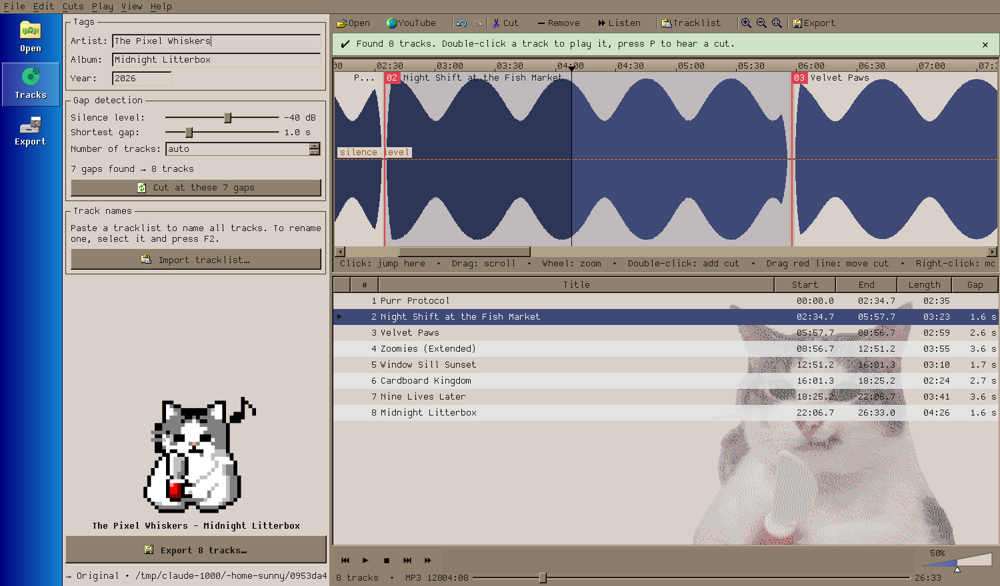
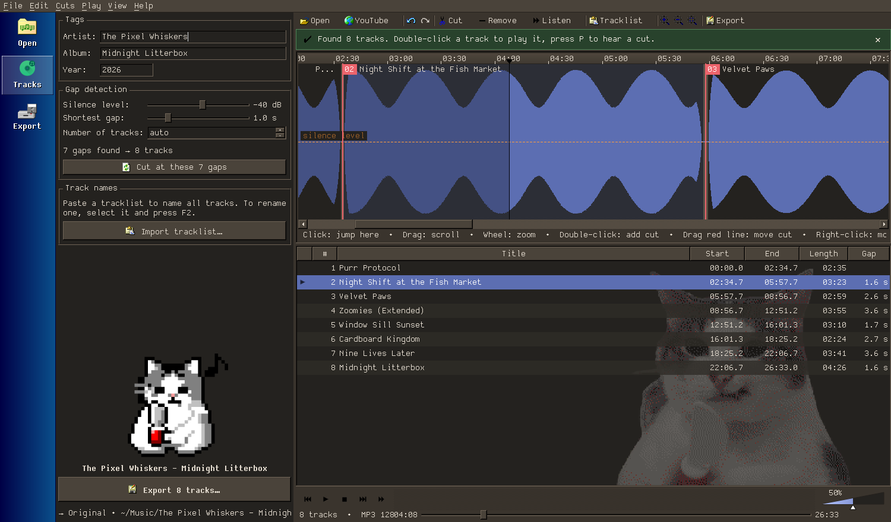
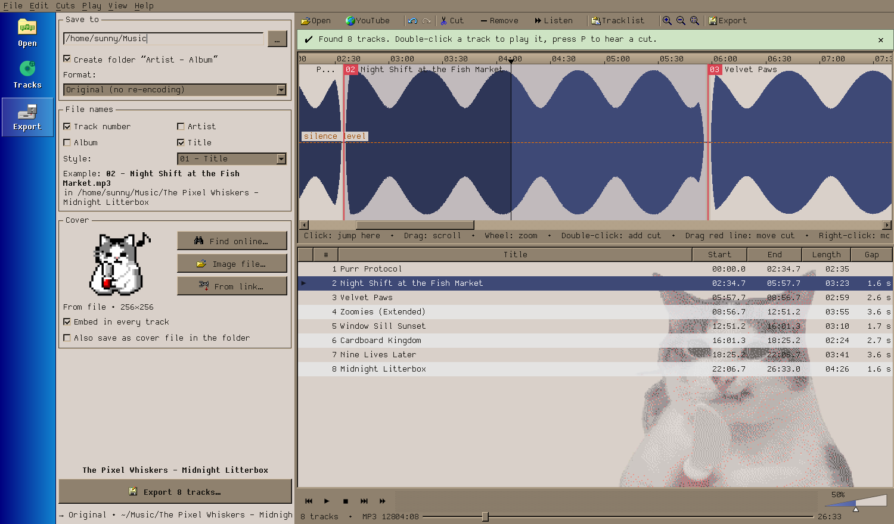

# Cuttycat

Splits one long recording (album rip, DJ mix, YouTube upload) into separate tracks.

Cuttycat finds the gaps, lets you check and move every cut, names the tracks from a pasted
tracklist or a video's chapters, and exports them with tags and cover.



## Features

- **Cuts at gaps**: the silence threshold is drawn on the waveform as you adjust it
- **Waveform editor**: drag cuts, double-click to add one, `P` plays the seconds around a cut
- **Tracklist import**: paste from Discogs, Bandcamp, MusicBrainz, a YouTube description …
  Track numbers, `Artist - Title` order and timestamps (start times or lengths) are detected
- **YouTube import** (via [yt-dlp](https://github.com/yt-dlp/yt-dlp)): downloads the audio, cuts at
  the chapters or the tracklist in the description, uses the thumbnail as cover
- **Cover**: from the file, an image, a link, or found online (iTunes, Deezer, MusicBrainz);
  crop 16:9 thumbnails to a square
- **Export** all tracks or just the selected ones, as the original audio (no re-encoding), FLAC,
  MP3, Opus or Ogg, with tags and cover
- Light and dark theme, following the system by default

| Dark theme | Export settings |
|---|---|
|  |  |

## Download (standalone)

Grab `cuttycat` from the [releases page](../../releases), make it executable and run it:

```sh
chmod +x cuttycat
./cuttycat
```

It contains Python, Qt, yt-dlp and everything else. Only **ffmpeg** has to be installed
(`ffmpeg` and `ffprobe`), e.g. `sudo apt install ffmpeg`, `sudo dnf install ffmpeg` or
`sudo pacman -S ffmpeg`. Linux x86_64.

## Install from source

Needs Python 3.10+ and ffmpeg.

```sh
git clone https://github.com/Tw0ngo/cuttycat
cd cuttycat
pipx install ".[all]"      # or: pip install --user ".[all]"
cuttycat
```

Or run it without installing:

```sh
pip install -r requirements.txt
python -m cuttycat [file]
```

`yt-dlp` (YouTube import) and `mutagen` (covers in Opus/Ogg files) are optional.

To get a menu entry, copy `cuttycat.desktop` to `~/.local/share/applications/` and
`cuttycat/assets/icon.png` to `~/.local/share/icons/hicolor/256x256/apps/cuttycat.png`.

## Using it

1. **Open** a file (or drop it on the window), or **Import from YouTube**.
2. **Tracks**: double-click a track to play it, `P` plays the seconds around the selected cut.
   Drag red lines to move cuts, double-click the waveform to add one, `Del` removes the cut before
   the selected track. Name the tracks with **Import tracklist** or `F2`.
3. **Export**: pick format, file names and cover on the Export page, then click **Export** and
   choose a folder. Right-click a track to export only that one.

`Ctrl+Z` undoes any change. Help → *Keyboard and mouse* lists all shortcuts.

Cuttycat has no project files: cuts and names are kept until you close the app, so export first.

When a file has no cover, Cuttycat looks one up on iTunes, Deezer and MusicBrainz (it sends the
artist and album name). Turn this off under Edit → *Look for covers online*.

Only download and split recordings you have the rights to.

## Building the standalone file

```sh
pip install ".[all]" pyinstaller
./packaging/build-standalone.sh     # creates dist/cuttycat
```

## Tests

```sh
pip install pytest
pytest
```

## Fonts

The UI uses a bitmap-style monospace font if one is installed (Dina, Terminus, …) and falls back
to the system's monospace font. To bundle a font, put the `.ttf`/`.otf` file into
`cuttycat/assets/fonts/` (check that its license allows redistribution).

## License

MIT. Made by Twongo.
